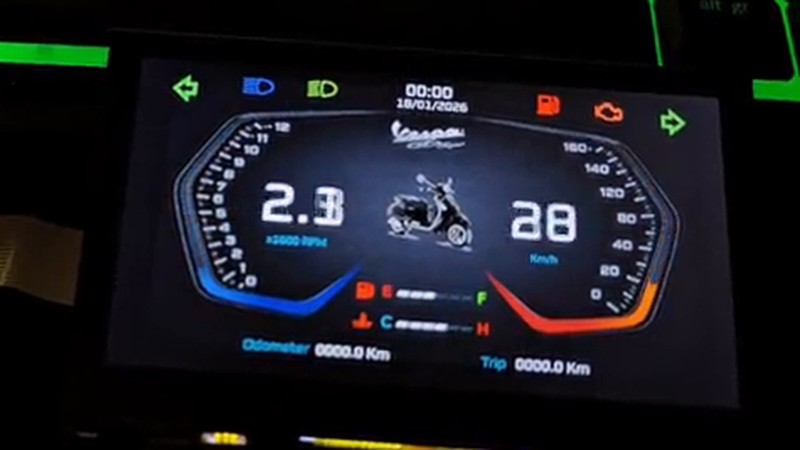
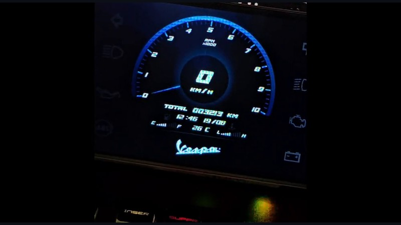
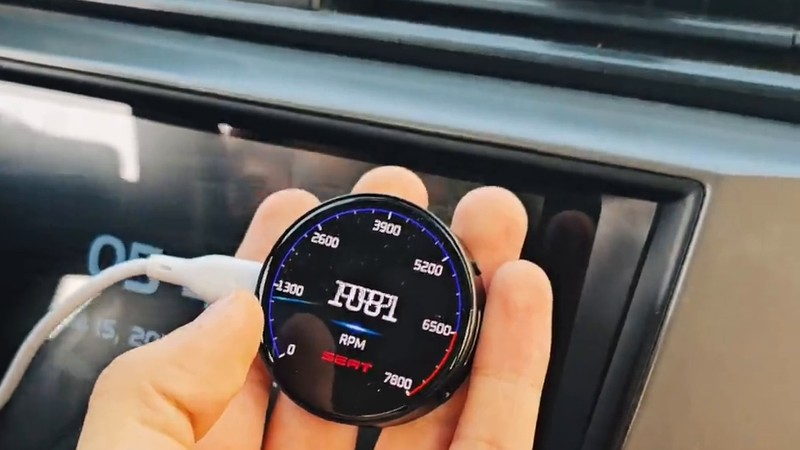
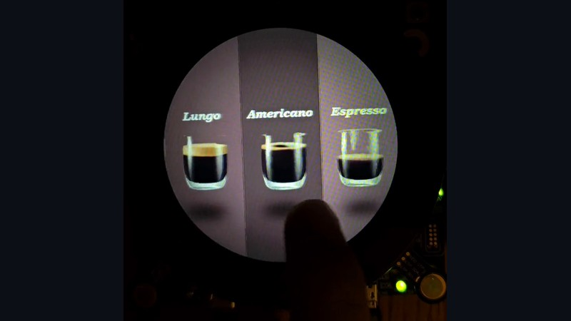
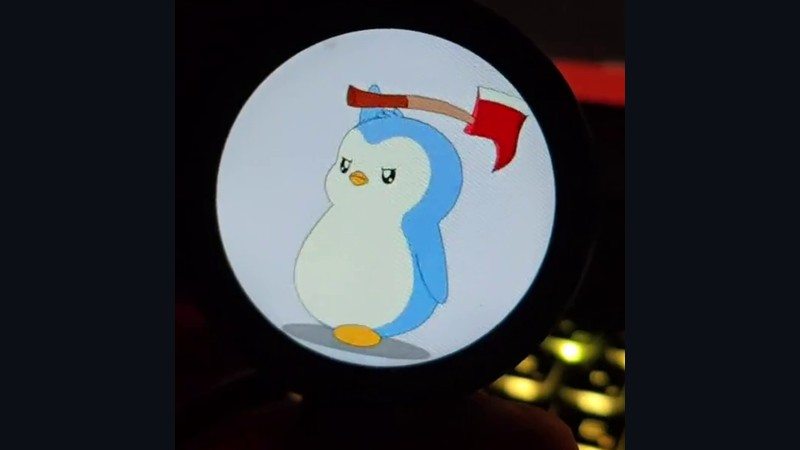
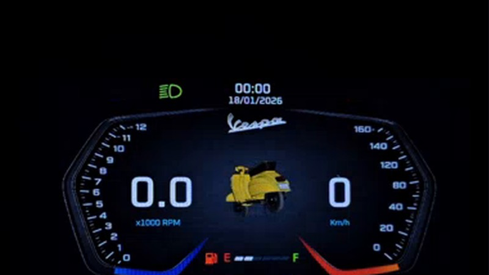

<h1 align="center">Ilyes Karaani</h1>
<h3 align="center">Embedded Software Engineer | HMI & Embedded Linux</h3>

 

Embedded software engineer with over five years of experience developing firmware, graphical interfaces and connected devices. I bridge low-level hardware integration and application development to build responsive, reliable embedded products.

## Selected projects

<table>
<tr><td width="50%" valign="top" align="center"><h3>Motorcycle digital instrument cluster</h3>
Qt-based embedded HMI and instrumentation.
<a href="assets/motorcycle-cluster.mp4">Watch demonstration</a></td><td width="50%" valign="top" align="center"><h3>Vespa digital speedometer</h3>
Custom dashboard, gauges and status indicators.
<a href="assets/vespa-speedometer.mp4">Watch demonstration</a></td></tr>
<tr><td width="50%" valign="top" align="center"><h3>BLE vehicle instrument</h3>
Compact circular vehicle-oriented display.
<a href="assets/ble-instrument.mp4">Watch demonstration</a></td><td width="50%" valign="top" align="center"><h3>Coffee machine HMI</h3>
Appliance interface with circular display.
<a href="assets/coffee-machine.mp4">Watch demonstration</a></td></tr>
<tr><td width="50%" valign="top" align="center"><h3>Smart display tag</h3>
Compact display with animated visual content.
<a href="assets/smart-tag.mp4">Watch demonstration</a></td><td width="50%" valign="top" align="center"><h3>Digital dashboard prototype</h3>
Custom graphical gauges and instrument visualization.
<a href="assets/dashboard.mp4">Watch demonstration</a></td></tr>
</table>

## Engineering expertise

| Area | Technologies |
| --- | --- |
| Firmware | C, C++, STM32, ESP32, Nordic nRF |
| Graphical interfaces | LVGL, TouchGFX, Qt/QML |
| Embedded operating systems | FreeRTOS, Embedded Linux, Buildroot, Yocto |
| Hardware integration | MIPI DSI, SPI, I2C, UART, GPIO |
| Connectivity | CAN, Modbus, RS485, Bluetooth, Wi-Fi |
| Debugging | ST-Link, J-Link, TRACE32 |

## Professional services

- Embedded firmware architecture and development
- HMI and graphical interface implementation
- Embedded Linux integration and customization
- Display bring-up, peripheral integration and debugging
- Performance optimization and prototyping

## Let's collaborate

[Connect on LinkedIn](https://www.linkedin.com/in/ilyes-karaani/) · [Hire me on Upwork](https://www.upwork.com/freelancers/ilyeskr?mp_source=share)
